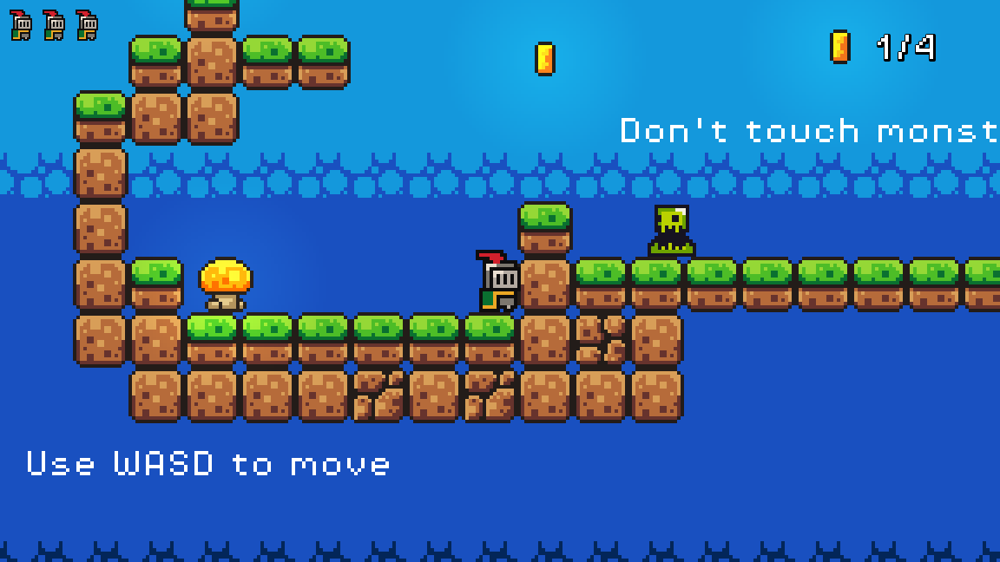
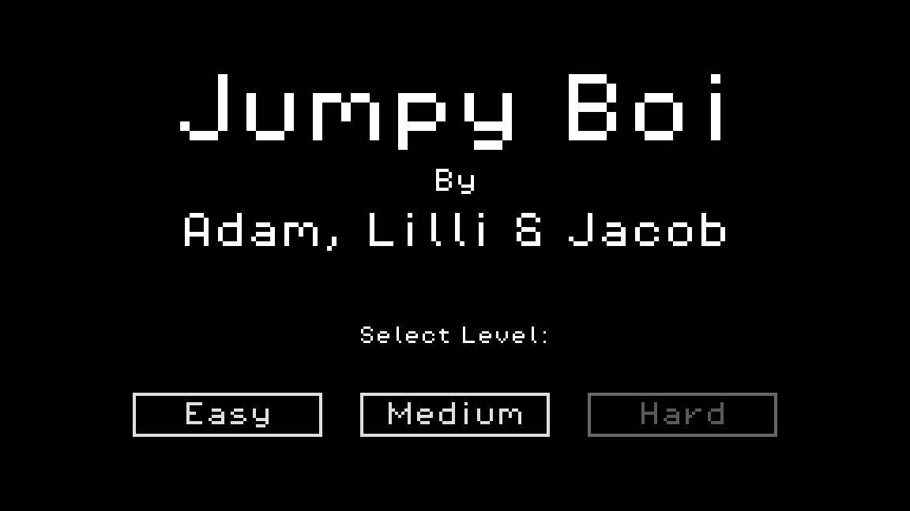

# Jumpy Boi

A small 2D platformer we make together as a family. The kids design the levels
and record the sound effects, dad writes the code. Collect every coin without
touching the monsters. Fall off and you respawn at the last checkpoint, with
three lives per level.

**Play it in the browser:** <https://fredsoe.io/platformer> (keyboard, or
on-screen buttons on an iPad or phone).

## Controls

| Action  | Keyboard                 | Touch screen          |
| ------- | ------------------------ | --------------------- |
| Move    | A / D or Left / Right    | on-screen arrows      |
| Jump    | Space, W or Up           | on-screen jump button |
| Restart | jump, after you have won | jump button           |

A gamepad d-pad or left stick moves too.

## How it is made

- [Godot 4.7](https://godotengine.org/), written in GDScript.
- The game is written in C# first, in a private repo, and ported here because
  Godot cannot export C# projects to the web, and the web is where the kids
  play it.
- On a touch screen the level shows three on-screen buttons that feed the same
  input actions as the keyboard, so the player code never knows the difference.

## Run it yourself

Open the folder in the standard Godot 4.7 editor (not the .NET build) and
press Play. The `Web` export preset produces the browser build; it has threads
turned off, so the result runs as plain static files on any web server.

## Credits

- Levels and sound effects (jump, land, coin, death, the slimes): Adam & Lilli.
- Code: Jacob.
- Sprites, music, font and the remaining sounds:
  [Brackeys' Platformer Bundle](https://brackeysgames.itch.io/brackeys-platformer-bundle)
  (CC0). `LICENSE & CREDITS.txt` lists the individual artists.
